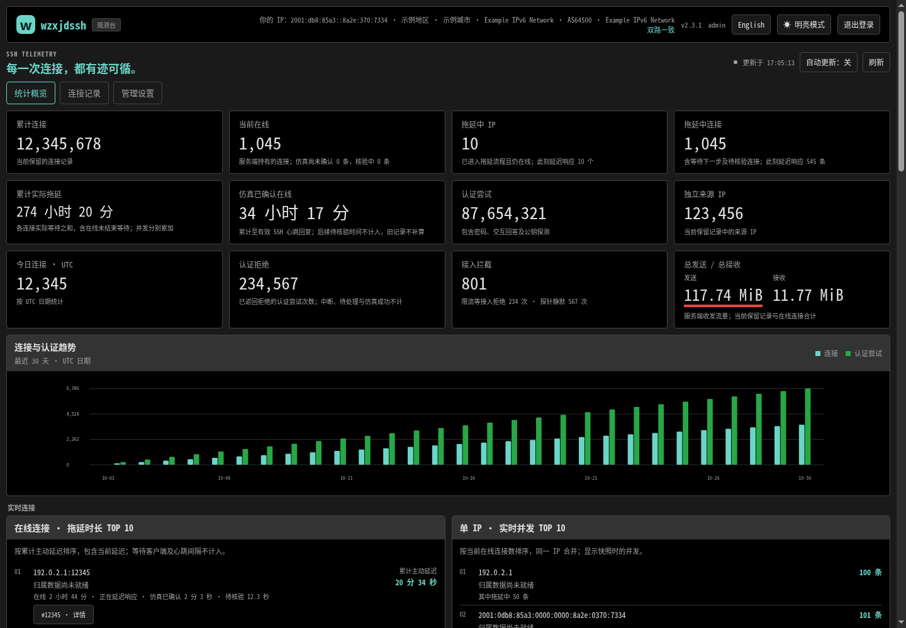

# wzxjdssh

[](README.md) [](README.en.md)

**wzxjdssh** comes from the pinyin initials of **“我这系假的SSH”**: *wo zhe xi jia de SSH*. The SSH suffix is kept as the protocol abbreviation.

A Docker-deployed SSH honeypot with real SSHv2 negotiation, delayed authentication rejection, isolated simulated sessions, SQLite records and a web console.

Current release: **2.3.1**. Image: `ghcr.io/ettijbaqaee/wzxjdssh:2.3.1` for Linux amd64. The `latest` tag is also available.

The default SSH identification is `SSH-2.0-OpenSSH_10.6p1`, the version before the [OpenSSH 10.6p2 security fix](https://www.openssh.com/txt/release-10.6p2), without a Debian suffix. Only the advertised identification changes; the underlying implementation remains Go SSH. A non-empty `WZXJDSSH_SERVER_VERSION` overrides the default.

Settings shows the active SSH banner above Clear database. Confirm the administrator password to change it without restarting. The input fixes the `SSH-2.0-` prefix; enter only the version and optional comment. The complete identification must be printable ASCII and at most 253 bytes. Changes apply to new SSH connections and leave existing connections intact. Web changes are process-local and do not modify Compose or SQLite. Restarting or reloading configuration restores the existing Compose and configuration-file precedence.

## Management console preview

[](docs/images/admin-console.png)

The image uses example addresses and attribution data. Click to open the full image.

## Web console languages and appearance

The sign-in page and console support Chinese and English. On first visit, the browser's preferred language selects Chinese for `zh` variants and English for other languages. The **English / 中文** button changes the language and remembers the preference in the browser. Switching language reloads the page while preserving the authenticated session.

Navigation, statistics, connection details, settings, warnings, version notices, dates and numbers follow the selected language. Submitted usernames, passwords, public keys and SSH client identifications remain unchanged. Location names and protocol identifiers retain their original database or protocol values.

Light and dark appearance follows the browser until manually changed. Theme changes use a short, gentle color transition without moving page elements. Browsers requesting reduced motion switch immediately.

## Traffic and trend statistics

The header shows the visitor's IPv4/IPv6 address, location, ASN and organization using the local databases. It compares a browser-side IP endpoint (`WZXJDSSH_VISITOR_IP_URL`, default `/get-my-ip`) with the trusted reverse-proxy or socket source. Different results are shown together; an unavailable endpoint falls back to the server-observed address. Configure `WZXJDSSH_TRUSTED_PROXIES` with only actual proxy IPs/CIDRs (default loopback; `none` ignores forwarded headers). The endpoint accepts JSON with an `ip` field or a plain IP address. A cross-origin endpoint needs CORS; no administrator credentials are sent to it. GeoCN downloads from `ljxi/GeoCN` first and falls back to PBH-BTN; City and ASN retain their existing sources.

The overview shows total SSH bytes sent and received by the server across retained history and live connections. A red thick underline marks sent traffic when it is larger; a green underline marks received traffic when it is larger. Equal totals have no colored underline. Deleting history or clearing the database also removes its traffic from the totals.

Hover over the trend chart, tap it on a touchscreen, or use the keyboard to see the UTC date and actual connection and authentication counts. The selected date is retained across refreshes and window resizing.

## How it works

In the default `ssh` mode, the server exchanges SSH identification strings, negotiates real key exchange, signs with persistent host keys and establishes an encrypted transport. Password, public-key and keyboard-interactive attempts are recorded. Authentication is normally rejected after a configurable wait: 10 seconds by default, with independent random jitter.

Connections interrupted by the client during authentication delay can receive a cooldown mark. A marked client that reconnects with the same IP and full SSH identification waits adaptively before receiving simulated authentication success. It then enters an isolated session with randomly delayed replies. **No system commands are executed, and no real shell, SFTP or port forwarding is provided.**

If an IP opens overlapping connections within the concurrency window, the concurrent-IP slow policy takes priority. Connections continue delayed rejection without creating authentication-timeout marks. The default cooldown is one idle hour after the last connection closes.

The optional `banner` mode slowly sends printable pre-identification lines ending in CRLF. The first line also waits. This mode does not complete an SSH handshake.

Slow connections have no fixed lifetime limit. New admissions can evict the longest-held slow connection when capacity is full. Client timeouts and disconnects still end connections; a honeypot cannot override a client's own deadlines.

## Quick start with Docker Compose

Use [compose.release.yaml](compose.release.yaml) with [.env.example](.env.example). Import the Compose file in 1Panel, set the environment values, and deploy it from **Containers → Compose**.

Set at least a long, unique administrator password:

```dotenv
WZXJDSSH_ADMIN_USERNAME=admin
WZXJDSSH_ADMIN_PASSWORD=replace-with-your-own-long-password
WZXJDSSH_PORT=2222
WZXJDSSH_WEB_PORT=2223
WZXJDSSH_WEB_BIND=127.0.0.1
WZXJDSSH_WEB_BASE_PATH=/wzxjdssh/
```

An empty admin username defaults to `admin`. The password must contain at least 12 bytes. The supplied Compose file maps host SSH port `2222` to container port `2222`; set `WZXJDSSH_PORT=22` only after ensuring it will not conflict with the host's real SSH service. Web access is bound to host loopback by default. Use an HTTPS reverse proxy for remote administration.

The server defaults to `SSH-2.0-OpenSSH_10.6p1`. Set `WZXJDSSH_SERVER_VERSION` to another full ASCII `SSH-2.0-...` string if needed. An empty value in the supplied Compose file expands to `SSH-2.0-OpenSSH_10.6p1` and overrides the image's built-in identification. This changes the identification string, not the underlying SSH implementation. No host SSH port detection is performed.

The Chinese [Compose and upgrade guide](COMPOSE.zh-CN.md) documents every environment setting, host networking, bind mounts and reverse-proxy examples. [Default configuration](configs/wzxjdssh.conf) lists the core policy values.

## Ports, configuration and storage

| Item | Default / behavior |
| --- | --- |
| SSH port | `2222` inside the container |
| Web listener | `:2223`; the supplied Compose binds the published port to `127.0.0.1` |
| Web base path | `/wzxjdssh/` in the supplied Compose |
| Authentication / banner delay | `10000` milliseconds; the first banner line also waits |
| Delay jitter | `10%`, configurable from 0 to 50 |
| Banner line length | 32 bytes including CRLF; range 3–255 |
| Total connections | 4096; actual capacity depends on available resources |
| Concurrent connections per IP | 64; `0` disables this limit |
| Connections per IP per minute | 2048; `0` disables this limit |
| Authentication attempts per connection | Unlimited by default |
| Credential deadline | 20 seconds per connection |
| Address family | Automatic; IPv4 / IPv6 behavior depends on the platform |
| Configuration file | `/etc/wzxjdssh/config` |
| Host keys | `/data` |
| SQLite and IP databases | `/var/lib/wzxjdssh` |
| Record retention | 90 days; configurable in Compose |
| Database size limit | Disabled unless `WZXJDSSH_DATABASE_MAX_MB` is set |

Non-empty policy environment variables override the configuration file. Command-line options override corresponding settings. `-v` enables connection logging; `-vv` enables debug logging. Times are in milliseconds unless the parameter name states otherwise. Settings in the console display the running configuration.

Keep both persistent volumes across upgrades. Bind-mounted directories must be writable by container UID/GID `65532:65532`, unless your Compose explicitly uses another user to initialize them. Only one instance may write to a given SQLite directory. Back up a stopped service's entire records volume, or use the SQLite Backup API for a live backup; copying only the main database may omit WAL data.

Version 2.2.0 validates existing database structure and integrity before listening. The records volume also contains `records.sqlite.initialized`. If a previously initialized database is missing, truncated or damaged, startup is refused. Detected file loss, replacement, obvious damage or permanent SQLite read/write errors during operation stop SSH and Web with a nonzero exit status. Existing files are preserved; no empty replacement database is created. Stop the deployment, preserve the affected directory and restore a complete backup. A first-time empty directory is initialized normally. If the entire directory and its initialization marker disappear together, the application cannot distinguish that from a first deployment.

Captured authentication data is sensitive. Restrict access to the console, volumes and backups. A public-key probe records the public key supplied by the client and does not prove possession of its private key.

`WZXJDSSH_DATABASE_MAX_MB=1024` enables an approximately 1 GiB database limit, including WAL/SHM. Cleanup removes the oldest history first and aims for about 90% of the limit to reduce repeated cleanup. Active connection metadata is retained. Writes and cleanup can briefly exceed the limit. The limit does not cover logs, backups, host keys or IP databases.

## Monitoring and management

- Statistics include active connections, delayed IPs, total server-imposed delay, attempted usernames and passwords, authentication methods and client identifications.
- IP connection records group different source ports under one IP, with newest/oldest pagination and individual connection details.
- Live concurrency and delay rankings show active connections. The historical longest-connection ranking uses the longest single duration per IP; accumulated server delay is displayed separately.
- Details include authentication attempts, SSH client identification, marks, traffic counts, liveness timestamps and simulated-session stages when available.
- Admin sessions expire after one hour without user activity by default. The console can persist a value from 1 to 1440 minutes. Automatic refresh does not extend a session. Restarting the container invalidates sessions.
- Emergency protection closes service TCP connections and pauses new SSH handling for 60 seconds. The web console remains available. It does not modify host firewall rules or require additional capabilities. Closing sockets can cause kernel FIN/RST packets.
- Clearing the database requires a warning dialog and the current admin password. It closes connections and pauses SSH first, then removes connection history, credentials, statistics and client marks. Settings, host keys and IP databases are kept. This operation cannot be undone.

Connections that do not submit credentials are handled individually. By default, a connection that has not submitted a username with a password, public key or interactive answer within 20 seconds is reclaimed without an IP mark. `none` authentication, a handshake alone or requesting an interactive challenge is insufficient. The required SSH negotiation still takes place before classification; socket closure may emit FIN/RST.

## Simulated sessions and liveness

Adaptive cooldown authentication starts at 10 seconds, decreases on early departure and increases only after a qualifying session. It stays between 3 and 15 seconds by default and applies random jitter. Learning is held in memory, discarded when the mark expires and reset on restart.

After simulated authentication succeeds, the server immediately requests an SSH-level liveness reply, even if the client opens no channel. Later requests follow the configured interval. Either a corresponding success or failure reply confirms the SSH client is responding; TCP ACKs and elapsed server time do not.

The defaults are a 60-second interval, 30-second response windows and three missed windows. Only one request per connection can be outstanding. The response calculation excludes deliberate local delays but also has a hard overall bound, preventing endless extension. FIN/RST disconnects are reclaimed promptly. Responsive slow connections have no fixed lifetime deadline.

The teal duration in the live-connections ranking is labeled **Total server delay**. It sums deliberate authentication and response waits, including the ongoing delay. Waiting for the client, heartbeat intervals and connection age alone are excluded. Online duration and verified simulated time remain separate measures.

“Verified simulated time” advances only to the latest valid SSH reply. The subsequent unconfirmed tail is shown separately. Older records are not retroactively estimated. Connection duration, confirmed time and actual server delay measure different things. SSH responsiveness does not establish that a scanner has stopped other work.

## IP geolocation

Local GeoLite2-City, GeoLite2-ASN and GeoCN data are merged for City, ASN, Chinese administrative divisions, ISP and network-type labels. Lookups use a bounded LRU cache and do not run inside SSH handling. IPv4 and IPv6 are supported.

Missing databases download in the background. Existing databases update every 45 days by default; failures keep the previous files. The console provides status and a manual update button. The default cache holds 300 entries with a 300-second idle expiry. IP location is approximate and does not identify an attacker or exact address.

City and ASN data from MaxMind GeoLite2 are distributed through [PBH-BTN/GeoLite.mmdb](https://github.com/PBH-BTN/GeoLite.mmdb/releases). GeoCN downloads directly from [ljxi/GeoCN](https://github.com/ljxi/GeoCN/releases) first and falls back to PBH-BTN raw and Release URLs. See [geodata/README.md](geodata/README.md) and [third-party notices](THIRD-PARTY-NOTICES.txt). The databases live under the records directory, separately from the SQLite size cap and clear-database action. Reserve disk space for both databases and update files.

## Release notifications and upgrades

After sign-in, the console checks the latest stable GitHub release. A newer version adds a red oval with white **new** text next to the current version. Clicking it opens the [latest GitHub release](https://github.com/EttijBaqaee/wzxjdssh/releases/latest). Settings includes a manual check.

Checks have an 8-second timeout and one request in flight, use ETag and cache successful results for one hour. Automatic retries after failure wait ten minutes; manual checks are limited to one every 30 seconds. Failures preserve the last valid result and display a reason. Draft and prerelease versions are excluded.

To upgrade to **2.3.1**, pull `ghcr.io/ettijbaqaee/wzxjdssh:2.3.1`, change the original Compose image tag, and recreate the service while keeping its data volumes and project name. No new environment variables are needed for language or theme controls. The existing host-network, port 22, web port 2223 and reverse-proxy path settings remain compatible.

Upgrading from 2.3.0 keeps SQLite schema version 4, existing data volumes and SSH settings. Visitor display uses the default endpoint unless `WZXJDSSH_VISITOR_IP_URL` is changed; configure `WZXJDSSH_TRUSTED_PROXIES` for the actual proxy addresses. Upgrading from 2.2.0 also backfills traffic summaries on first startup. The project is licensed under AGPLv3; see [LICENSE](LICENSE).

Release assets include the runtime image, runtime source and deployment documentation. See [CHANGELOG.md](CHANGELOG.md) for release changes.

Version 2.2.0 upgrades the SQLite schema to version 4 and maintains transactional summaries for statistics and rankings. Stop the Compose deployment and back up the records volume before upgrading. Allow extra disk space for migration and WAL files. To roll back, restore both the earlier image and its database backup; earlier binaries cannot open the upgraded schema. Existing Compose parameters remain valid.

## License

Copyright (c) 2026 EttijBaqaee.

This project is licensed under the [GNU AGPLv3](LICENSE), version 3 only (`AGPL-3.0-only`). Third-party dependencies retain their own licenses; see [THIRD-PARTY-NOTICES.txt](THIRD-PARTY-NOTICES.txt).
